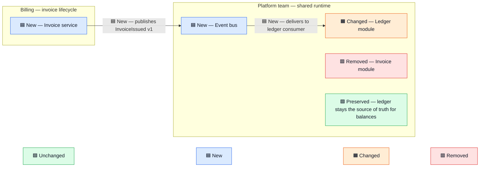

# semantic-diagrams

Ownership-aware architecture, migration, and before/after diagrams in Mermaid. Every diagram
groups components under a named owner, marks each component and flow with one of four fixed
statuses, and carries a legend, so diagrams from different people and sessions read the same
way.

Ported from the Codex `semantic-diagrams` skill. The Codex version deferred rendering to a
host-side `visualize` skill that Claude Code does not have. This version writes the diagram
to a self-rendering HTML page, opens it locally, and publishes it as an Artifact on request.
Raw Mermaid never lands in the terminal.

## Installation

```
/plugin install semantic-diagrams@agent-toolkit
```

## Usage

The skill triggers on its own when a design discussion, PR description, design doc, or
architecture explanation would be clearer as a diagram, or when asked directly:

```
Diagram how invoice events would move from the monolith to a dedicated service.
Write the PR description with a before/after diagram of the ownership change.
Map which team owns each service in the checkout flow.
```

It does not trigger for charts, plots, geographic maps, UI mockups, or interactive tools.

## Where the diagram appears

| Situation | Output |
| --- | --- |
| Diagram inside a file being written (PR body, design doc, README) | Fenced Mermaid block in that file. GitHub, Linear, and Notion render it. |
| Diagram in the reply | A local HTML page in the session scratchpad, opened in the default browser. The reply names the path and says what the diagram cannot show. No Mermaid source in the terminal. |
| User asks to publish, share, or get a link | The same page is published as an Artifact at a private URL. |
| Artifact tool not available in the session | Says so; the local page is the output. |

## Status encoding

| Status | Prefix | Fill |
| --- | --- | --- |
| Unchanged / preserved | `🟩 Unchanged —` / `🟩 Preserved —` | green |
| New | `🟦 New —` | blue |
| Changed | `🟧 Changed —` | amber |
| Removed | `🟥 Removed —` | red |

The local page and the Artifact are themed by the page: light or dark tokens are passed to
Mermaid at load, and the four status classes get dark tinted fills in dark mode. Markdown
renderers (GitHub, Linear, Notion) ignore page CSS and draw their own default theme plus the
fixed pastel status fills, which stay readable on either background. A prettier page was
chosen over identical output everywhere.

Nodes get their colour from a `classDef`. In Markdown the legend is a row of four nodes
joined by invisible links. The local page and the Artifact drop that row and show an HTML
legend above the diagrams, which stays the same readable size however wide the diagram is. Arrows carry status in their label text only, never
via `linkStyle`, because `linkStyle` colours arrows by their position in the file and moves to
the wrong arrow when one is inserted above it. Icon and text always accompany the colour, so
the diagram reads correctly without colour.

## Example

Proposed state for moving invoice events out of a monolith:


