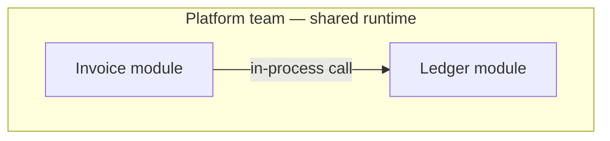
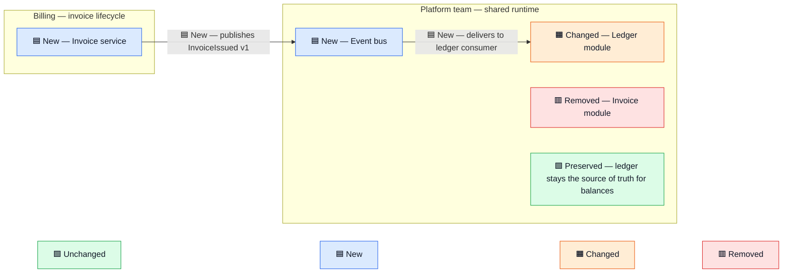

# Semantic Diagrams

Produce Mermaid flowcharts whose boundaries name an owner and whose components and flows carry
an explicit status. Every diagram from this skill uses the same four statuses, the same
colours, and the same legend, so diagrams from different sessions and different people read
the same way.

## When to draw

- Draw only when the diagram makes the explanation clearer than prose alone. A list of three
  services with one arrow between them is prose.
- A request for a table gets a Markdown table, not a diagram.
- Out of scope: quantitative charts and plots, geographic or spatial maps, UI mockups,
  interactive tools. A service, architecture, or capability map stays in scope when it needs
  owners, flows, statuses, or a before/after comparison.

## Where the diagram goes

**Into a file the user is writing** (PR description, design doc, README, Linear or Notion
page): write the fenced ` ```mermaid ` block into that file. GitHub, Linear, and Notion render
it. Do not build a page or offer an Artifact unless asked.

**In the reply itself**: never paste the Mermaid source into the reply. The terminal shows it
as raw text, which nobody can read as a diagram. Instead:

1. Copy `assets/diagram.html` from this skill's directory to the session scratchpad (or the
   directory the user names) as `<kebab-title>.html`. Replace `TITLE`, the one-sentence
   intro, and the `<div class="mermaid">` blocks, one per diagram, with `<h2>` headings that
   name each state. The blocks are `<div>`, not `<pre>`, so the Artifact host does not run
   its own stock-themed render on top of the page's. Never put a `%%{init}%%` directive in
   the source; the page owns the theme. Inside those blocks escape `<` as `&lt;` and `&` as `&amp;`; a label
   like `api/db/<table>.py` is otherwise parsed as an HTML tag and the whole diagram fails
   with "Syntax error in text". Arrows (`-->`) need no escaping. Leave the
   `<script type="module">` block alone; it loads Mermaid from jsdelivr and renders the page
   in any browser and applies the page's light or dark tokens to it.
2. Open it: `open <path>` on macOS, `xdg-open <path>` on Linux. Name the path in the reply.
3. Publish it as an Artifact only when the user asks to publish, share, or get a link, or
   when the request already said so. Pass the same file to the Artifact tool; the page
   renders identically there. If the Artifact tool is not available, say so in one sentence.

The reply then carries only the file path, the prose the diagram cannot show (see below),
and one line saying the page can be published on request.

## Diagram grammar

Always use `flowchart` (LR or TB). `subgraph`, `classDef`, and `:::class` are flowchart
syntax; `sequenceDiagram` and the other Mermaid types cannot carry owner boundaries or status
colours. A process whose order matters is still a flowchart with numbered or labelled edges.

1. **Establish the facts before drawing.** Separate the actual current state from the
   intended future state. Do not infer components, owners, flows, or statuses the user did
   not provide or the code does not show. Mark an uncertain or proposed item as such
   (`❔ Proposed —`) instead of presenting it as current fact.
2. **Group components in named `subgraph` boundaries that state the owner or
   responsibility**, such as `Platform team — shared runtime` or `Billing — invoice
   lifecycle`. Keep cross-boundary interactions visible. Nodes inside a `subgraph` stack
   vertically regardless of the flowchart direction; when a chain inside one boundary should
   read left to right, put `direction LR` as the first line of that `subgraph`.
3. **Encode status explicitly** on any component or relationship whose status matters,
   using the fixed encoding below. Pair the colour with its icon and text in the diagram
   itself; colour must never be the sole carrier of meaning. Include the legend whenever
   statuses are encoded. Show preserved constraints explicitly as a `🟩 Preserved — ...`
   node near the affected boundary or flow.
4. **Keep labels short**: a node is the status prefix plus at most six words; a boundary
   title is the owner plus at most four words, or it wraps into its own border. Detail that
   does not fit goes on an arrow label or in the prose. Long labels make tall nodes, and tall
   nodes make the whole graph sprawl.
5. **Label any arrow whose meaning is not obvious from its endpoints**: a data contract, an
   authorization decision, an ownership handoff, a migration copy, a control-plane action.
   Leave self-evident containment and simple sequence edges unlabelled.
6. **Prefer two coordinated diagrams**, `Current state` and `Proposed state`, when a combined
   before/after view would obscure ownership, flow, or statuses. Use a single combined diagram
   only when the delta stays easy to read. Name each state in a heading or bold line above its
   block, not as an outer `subgraph` wrapping the whole diagram.

## Status encoding (fixed)

Use exactly these four statuses, prefixes, and colours. Do not invent others. The only
additional marker is `❔ Proposed —` for an item that is uncertain or not yet decided; it has
no colour class.

| Status | Node label prefix | classDef |
| --- | --- | --- |
| Unchanged or intentionally preserved | `🟩 Unchanged —` / `🟩 Preserved —` | `unchanged` |
| Newly introduced | `🟦 New —` | `new` |
| Modified from current state | `🟧 Changed —` | `changed` |
| Removed or retired | `🟥 Removed —` | `removed` |

Theme comes from the page, not the diagram. `assets/diagram.html` reads its light or dark
tokens at load and passes them to Mermaid: transparent background, faint boundary boxes with
thin borders, surface-coloured nodes, foreground text. After rendering, its script recolours
the four status classes from the same tokens (dark tinted fills and light text in dark mode),
because Mermaid's own stylesheet inside the SVG beats page CSS. The page re-renders every
diagram when the system appearance or the Artifact theme changes, so the diagram never shows
one theme's colours on the other theme's background. Markdown renderers such as GitHub ignore
all of that and draw Mermaid's default theme plus the fixed pastel `classDef` fills below,
which stay readable on both light and dark pages. Do not add `%%{init}%%` directives; they
would override the page theme.

Paste this block at the end of every diagram that encodes status. The last line is the
legend: four nodes joined by invisible links so they render as one row. Keep it in the page
too: `assets/diagram.html` drops that line before rendering and shows its own HTML legend
above the diagrams instead, at page text size and hidden when no node carries a status. A
Markdown renderer has no such legend, so the line is what GitHub, Linear, and Notion show.

```
  classDef unchanged fill:#dcfce7,stroke:#16a34a,color:#111827
  classDef new       fill:#dbeafe,stroke:#2563eb,color:#111827
  classDef changed   fill:#ffedd5,stroke:#ea580c,color:#111827
  classDef removed   fill:#fee2e2,stroke:#dc2626,color:#111827

  L1[🟩 Unchanged]:::unchanged ~~~ L2[🟦 New]:::new ~~~ L3[🟧 Changed]:::changed ~~~ L4[🟥 Removed]:::removed
```

Rules:

- Assign a node's class with `:::name` on the node itself, e.g. `api[🟦 New — Invoice API]:::new`.
- Nodes with no material status get no prefix and no class.
- Do not wrap the legend in a `subgraph`. A legend subgraph loses its title and stretches the
  owner boxes next to it.
- **Arrows carry status in their label text only**, e.g. `-->|"🟦 New — publishes invoice events"|`.
  Never use `linkStyle`. It colours arrows by position in the file, so inserting or reordering
  one arrow moves every colour after it onto the wrong arrow.
- The explicit `color:#111827` keeps label text dark on the light fills in both light and dark
  renderers. Do not remove it.
- Quote arrow labels, and quote any node label containing `:`, `(`, `)`, or `|`. The `—` in
  the status prefix needs no quoting.

## Prose around the diagram

- Say only what the diagram cannot show: why a change is proposed, what is uncertain, what
  decision the reader is being asked to make.
- Do not restate the nodes or arrows in a sentence.
- Do not announce the skill, the word "Mermaid", or the rendering mechanism in user-facing
  prose. "The current and proposed layout is in <path>" is enough. The one-line publish offer
  at the end of a reply is the single exception.

## Worked example

Request: "Show how invoice events would move from the monolith to a dedicated service."

**Current state**



**Proposed state**



In a reply, both blocks go into a copy of `assets/diagram.html` and the reply carries the
path, one sentence on why the ledger module changes (it gains an event consumer), one on what
is undecided (who owns the event bus long-term), and the publish offer.

## Files

- `assets/diagram.html` — the page template. Two `<div class="mermaid">` blocks, light and
  dark tokens for the page and for Mermaid, an HTML status legend coloured from the same
  tokens, a post-render pass that recolours the four status classes, Mermaid loaded from
  jsdelivr.
